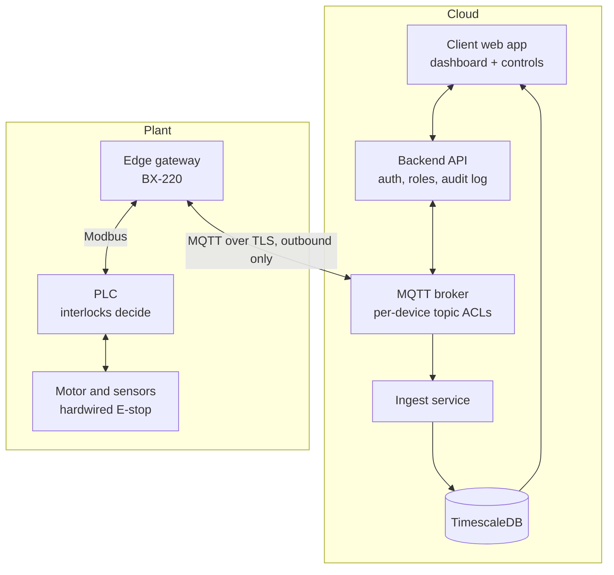
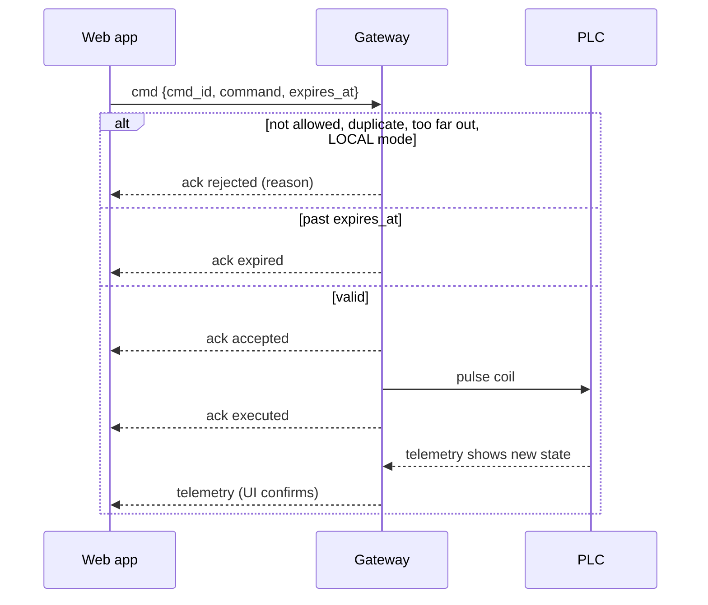

# Architecture

## Overview

Telemetry flows up: PLC → gateway → broker → ingest → database → dashboard.
Commands flow down: web app → API → broker → gateway → PLC. The PLC decides whether to act.

## The gateway

The BX-220 has two Ethernet ports. One faces the PLC network, the other faces the internet, and nothing routes between them. The PLC never touches the internet. The gateway opens connections outward only; no inbound ports.

Each poll cycle (default 1 s) the gateway:

1. Reads every tag in the tag map from the PLC.
2. Publishes telemetry (QoS 1) and a retained `state` snapshot.
3. Runs any queued commands.
4. Writes the heartbeat counter to the PLC, if enabled.

If the broker is unreachable, telemetry is held in a bounded in-memory queue and replayed on reconnect. `seq` lets the cloud spot gaps. A Last Will message marks the gateway `offline` if it dies without a clean shutdown.

## The write path

Once a remote click can move physical equipment, these rules apply.

**Safety stays local.** The PLC keeps every interlock and only accepts remote commands when the panel's Local/Remote selector is on Remote. The E-stop and safety circuits are hardwired and never pass through software.

**Allowlist, not raw writes.** The gateway only runs named commands like `motor_start`, each mapped to one coil or register in the config. The cloud can never say "write register 40011 = 1".

**Every command has an ID and an expiry.** A start that arrives 40 seconds late after a network hiccup is rejected, not executed. Expiry further out than `max_ttl_s` is rejected too. Duplicate `cmd_id`s run once.

**Confirm by feedback.** `executed` only means the write succeeded. The UI shows "requested" until telemetry reports the change, for example `motor_running: true`.

**Defined link-loss behaviour.** The gateway increments a heartbeat register. The PLC logic decides what to do when it stops changing (the simulator stops the motor and sets fault 9).

**Courtesy pre-check.** The gateway rejects commands when the last reading says the machine is in LOCAL mode. This gives a clear message to the operator; it does not replace the PLC's own check.

### Command lifecycle

## Security

- Per-device client certificates (mutual TLS) on the broker.
- Broker ACLs: each gateway publishes only its own topics and subscribes only to its own `cmd` topic.
- Operator accounts with 2FA and roles; every command recorded in the `commands` table.
- No inbound ports on the gateway. Remote admin through Tailscale or WireGuard, outbound only.
- Windows 10 IoT 2016 LTSB is out of support since 2026-10-13. Acceptable for read-only monitoring behind a locked firewall; settle ESUs from Contec or a migration date before enabling control.

## The UI

Grafana is fine for viewing. Control needs a small purpose-built app (for example FastAPI with React) or an IoT platform with device RPC, such as ThingsBoard.
